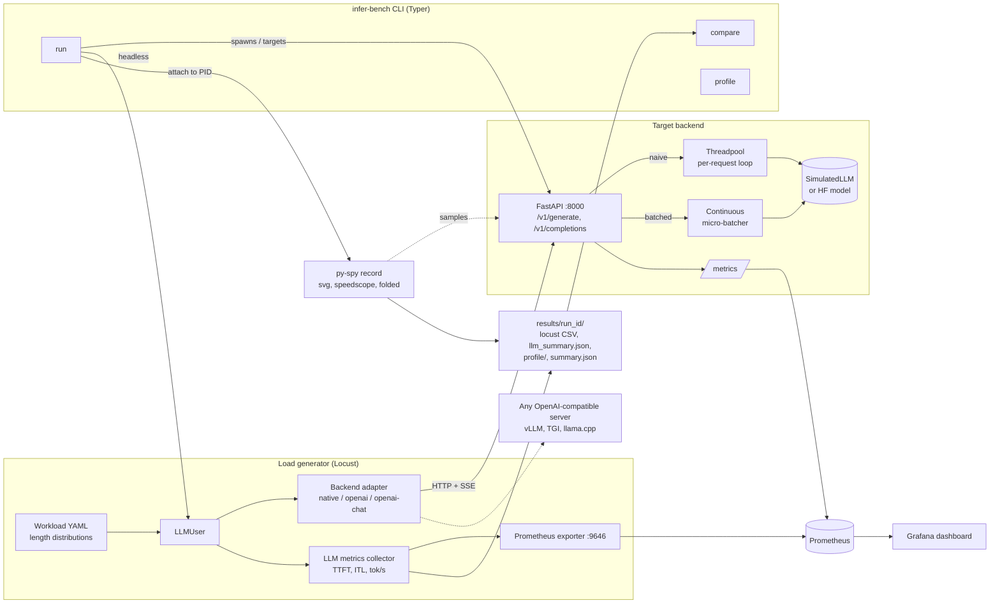
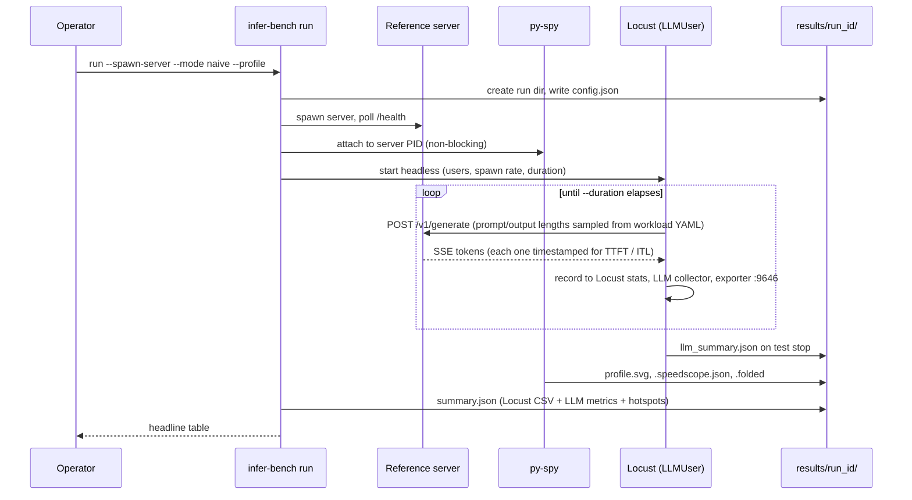

# infer_bench

**Load & profiling harness for LLM inference.**

infer_bench load-tests LLM inference backends and shows where the time goes. It:

- **drives load with Locust**, using workloads defined in YAML (distributions of prompt and
  output length, streaming or not, think time), against the bundled server or any
  OpenAI-compatible endpoint (vLLM, TGI, llama.cpp server, ...);
- **measures what matters for LLMs**: time-to-first-token (TTFT), inter-token latency,
  per-request decode speed, output tokens/sec, end-to-end latency percentiles and error rate;
- **profiles the server's CPU with py-spy** during the run (flamegraph SVG, speedscope JSON and
  a hotspot table built from collapsed stacks);
- **streams live metrics to Prometheus and Grafana** from both sides: what the server reports
  and what the clients actually see;
- **stores every run** in its own folder and **compares runs** (throughput ratios, latency
  deltas, and which functions gained or lost profile share).

It ships a **reference FastAPI inference server** with two serving modes so you can see the
effect of an optimisation end to end:

| Mode | How it serves | What limits it |
|---|---|---|
| `naive` | Each request runs its own generate loop on FastAPI's threadpool, one sequence per forward step | GIL contention, and paying the per-step overhead separately for every request |
| `batched` | An async queue feeds a continuous micro-batcher. One decode step moves every active sequence forward, sequences join and leave between steps | Per-sequence marginal cost |

With the default cost model (8 ms overhead per step, 1 ms per sequence, half of it CPU-bound),
`batched` should reach about 3x or more of `naive`'s output-token throughput at 32 concurrent
users. [Expected results](#expected-results-from-the-cost-model) shows where that number comes
from. Run `scenarios/naive_vs_batched.sh` to measure it on your machine.

## Architecture



### Run flow (`infer-bench run --spawn-server --profile`)



1. Create `results/<timestamp>_<label>/` and write `config.json`.
2. Start the reference server (or use `--target` to point at one that is already running) and
   wait for `/health`.
3. Attach py-spy to the server PID in non-blocking mode for the length of the test.
4. Run Locust headless. Every request goes through the backend adapter, streamed tokens are
   timed one by one, and the samples go to Locust, the in-process collector and the Prometheus
   exporter.
5. On test stop, the locustfile writes `llm_summary.json`. The CLI then merges it with Locust's
   CSV stats and the py-spy hotspots into `summary.json` and prints a headline table.

## Project layout

```
src/infer_bench/
  server/        config, SimulatedLLM + optional HF backend, micro-batcher, metrics, FastAPI app
  loadgen/       backend adapters, workload sampling, LLM metrics, Prometheus exporter, locustfile
  profiling/     py-spy wrapper + collapsed-stack hotspot analysis
  results/       run directories, summary building, run comparison
  cli.py         `infer-bench` entry point
workloads/       example workload YAMLs (chat_short, summarize_long, throughput)
scenarios/       naive_vs_batched.sh, external_openai.sh
deploy/          Prometheus config, Grafana provisioning + dashboard
tests/           pytest suite
```

## Requirements

- Python 3.10+
- `py-spy` (installed as a dependency). **On macOS it needs root**, so pass `--sudo-pyspy`
  or run the profiling step with `sudo`. On Linux it needs ptrace permission
  (`kernel.yama.ptrace_scope=0`, or the `SYS_PTRACE` capability in containers).
- Docker + Docker Compose for the Prometheus/Grafana stack (optional).
- You don't need a GPU or model weights. The default backend is a simulated model. The
  optional `hf` backend (`pip install -e ".[hf]"`) runs a small HuggingFace model on CPU.

## How to run

### 1. Install

```bash
python -m venv .venv && source .venv/bin/activate
pip install -e ".[dev]"
cp .env.example .env   # optional: tweak server cost model, ports, API key
```

### 2. Start the reference server

```bash
infer-bench serve --mode batched --port 8000
# or: INFER_BENCH_MODE=naive uvicorn infer_bench.server.app:create_app --factory
curl -s localhost:8000/v1/generate -d '{"prompt":"hello","max_new_tokens":8}' -H 'content-type: application/json'
```

### 3. Run a load test

```bash
# against the already-running server
infer-bench run --workload workloads/chat_short.yaml --users 32 --duration 60 --label chat

# spawn the server for the run and profile it with py-spy (macOS: add --sudo-pyspy)
infer-bench run --spawn-server --mode naive --target http://127.0.0.1:8100 \
    --workload workloads/throughput.yaml --users 32 --duration 60 --label naive --profile
```

Each run writes `results/<timestamp>_<label>/`:

| File | Contents |
|---|---|
| `config.json` | the run parameters |
| `locust_stats.csv`, `locust_stats_history.csv`, `locust_report.html` | Locust output |
| `llm_summary.json` | TTFT / ITL / tokens/sec percentiles from the client |
| `profile/profile.svg` | py-spy flamegraph |
| `profile/profile.speedscope.json` | open in https://www.speedscope.app |
| `profile/profile.folded` | collapsed stacks, used for the hotspot table |
| `summary.json` | everything merged, used by `compare` |

### 4. Compare runs

```bash
./scenarios/naive_vs_batched.sh                  # runs both modes, then compares them
infer-bench compare results/<naive_run> results/<batched_run> --markdown report.md
```

### 5. Benchmark an external OpenAI-compatible server

```bash
TARGET=http://gpu-box:8000 MODEL=meta-llama/Llama-3.1-8B-Instruct ./scenarios/external_openai.sh
# protected endpoint: export INFER_BENCH_API_KEY=... (sent as a Bearer token)
```

### 6. Live dashboards (Prometheus + Grafana)

```bash
docker compose up -d                         # server (batched), Prometheus :9090, Grafana :3000
docker compose --profile loadgen up -d       # also Locust with its web UI on :8089
```

Open Grafana at http://localhost:3000. The **infer_bench — LLM inference under load**
dashboard is provisioned automatically and shows request and token throughput, server vs
client latency and TTFT percentiles, batch size, queue depth, decode step time and
inter-token latency. Prometheus also scrapes `host.docker.internal:8000` and `:9646`, so
`infer-bench serve` / `infer-bench run` started on the host show up on the same dashboard.

To run Locust interactively without the CLI:

```bash
locust -f src/infer_bench/loadgen/locustfile.py --host http://localhost:8000 \
    --workload workloads/chat_short.yaml --backend native
```

### Profiling an arbitrary process

```bash
infer-bench profile --pid <server_pid> --duration 30 --out results/profile-adhoc
```

## CLI reference

```
infer-bench serve     [--mode naive|batched] [--backend simulated|hf] [--host 0.0.0.0]
                      [--port 8000] [--max-batch-size N] [--log-level warning]

infer-bench run       [--target URL] [--backend native|openai|openai-chat] [--model NAME]
                      [--workload workloads/throughput.yaml] [--users 32] [--spawn-rate 8]
                      [--duration 60] [--label run] [--results-root results]
                      [--spawn-server --mode naive|batched]
                      [--profile] [--server-pid PID] [--pyspy-rate 100] [--sudo-pyspy]
                      [--prometheus-port 9646]

infer-bench profile   --pid PID [--duration 30] [--out results/profile] [--rate 100]
                      [--sudo] [--native]

infer-bench summarize RUN_DIR                       # rebuild summary.json for a run

infer-bench compare   BASELINE_RUN CANDIDATE_RUN [--markdown report.md] [--json]
```

## Workloads

Each workload YAML describes the traffic shape. Every simulated user samples the prompt and
output lengths from these distributions, using a fixed seed so runs are reproducible.

| Workload | Prompt tokens | Output tokens | Streaming | Think time | Use it for |
|---|---|---|---|---|---|
| `chat_short.yaml` | lognormal, mean 96 (8–1024) | uniform 32–128 | yes | 0–0.5 s | Interactive chat, where TTFT and ITL matter |
| `summarize_long.yaml` | normal, mean 1500 ± 300 (512–3000) | fixed 200 | no | none | Prefill-heavy traffic and end-to-end latency |
| `throughput.yaml` | fixed 64 | fixed 64 | yes | none | Closed-loop saturation, used by `naive_vs_batched.sh` |

## Expected results from the cost model

These numbers are **worked out from the default cost model, not measured**. Use them as a
sanity check for your own `naive_vs_batched.sh` run.

With the defaults (`step_overhead_ms=8`, `per_seq_cost_ms=1`, `cpu_bound_fraction=0.5`),
`throughput.yaml` and 32 users:

| | `naive` | `batched` |
|---|---|---|
| Cost of one decode step | 8 + 1 = 9 ms for 1 sequence | 8 + 32 × 1 = 40 ms for 32 sequences |
| Part of that step that holds the GIL | 4.5 ms | 20 ms, on the single batcher thread |
| Output tokens/s ceiling | ~220 (one 4.5 ms CPU slice per token, serialised by the GIL across threadpool workers) | ~800 (32 tokens every 40 ms) |
| Inter-token latency per stream | grows with users, roughly 32 × 4.5 ms ≈ 145 ms at saturation | about one step, ~40 ms |

That puts the ceiling ratio at about 3.6x, which is where the "about 3x or more" above comes
from. The measured ratio is usually somewhat lower because of HTTP, SSE and Locust overhead,
and because naive mode also pays prefill once per request instead of once per batch. Raise
`cpu_bound_fraction` and the gap widens, since naive mode gets more GIL-bound. Lower it and
the gap shrinks, since sleeping threads overlap.

## Interpreting results

| Metric | What it tells you |
|---|---|
| **TTFT** (time to first token) | Queueing plus prefill. This is what makes a chat UI feel slow to start. |
| **ITL** (inter-token latency) | Decode cadence for each stream. In batched mode it tracks the decode step time. |
| **Per-request decode tok/s** | How fast a single user's answer streams in (roughly 1 / ITL). |
| **Output tokens/s** | Aggregate capacity of the server, which is the number to compare between modes. |
| **p50 vs p99** | The typical request vs the tail. A p99 far above p50 points to contention or queueing. |

A healthy run shows output tokens/s rising with users until the batch fills (`max_batch_size`),
with ITL staying close to the decode step time. An unhealthy run shows throughput flattening
while users keep rising, and ITL and TTFT climbing with every added user. Those are the signs
of a serialised bottleneck.

## Bottleneck guide

| Symptom | Where to see it | Likely cause | What to try |
|---|---|---|---|
| Throughput flat as users rise, ITL grows linearly with users | `summary.json`, Grafana *Client inter-token latency* | GIL-bound per-request loops (`naive` mode) | Batch decode steps (`batched` mode) |
| `_burn_cpu` / `spend` dominate self time across many threads | py-spy hotspot table, flamegraph | CPU-bound Python work contending on the GIL | Batch the work, or move it out of the interpreter |
| Batch size stays well below `max_batch_size` under load | Grafana *Batching* | Arrivals too sparse to fill a batch inside `batch_wait_ms` | Raise `batch_wait_ms` slightly, or add users |
| Queue depth keeps climbing, TTFT p99 spikes | Grafana *Queueing*, *Time to first token* | Offered load above capacity | Lower users, raise `max_batch_size`, or scale out |
| 503 responses, `rejected` in the request counter | Grafana *Client error rate*, server `/metrics` | Request queue full (`max_queue_size`) | Back off the load or raise the queue limit |
| Decode step time grows with batch size | Grafana *Decode step time* | Per-sequence cost dominates the fixed step overhead | Expected past the knee: batching has stopped paying off |

## Example compare output

`infer-bench compare` prints a colour-coded table to the terminal (Metric, Baseline, Candidate,
Ratio, Change), and `--markdown report.md` writes the layout below. The numbers here are
**illustrative**. They're estimated from the default cost model for `throughput.yaml` at
32 users, rounded down a little for HTTP and Locust overhead, and they are not from a recorded
run. Your hardware will move them, so run `scenarios/naive_vs_batched.sh` for real figures.

```
## 20251023-1912_naive -> 20251023-1915_batched

| Metric                         | Baseline | Candidate | Change                 |
|--------------------------------|---------:|----------:|-----------------------:|
| Requests/s                     |      3.2 |      10.9 | 3.41x / +240.6% (better) |
| Output tokens/s                |    205.0 |     698.0 | 3.40x / +240.5% (better) |
| Per-request decode tok/s (p50) |      6.6 |      23.1 | 3.50x / +250.0% (better) |
| Latency p50 (ms)               |  9,850.0 |   2,890.0 | 0.29x / -70.7% (better)  |
| Latency p99 (ms)               | 11,400.0 |   3,420.0 | 0.30x / -70.0% (better)  |
| TTFT p50 (ms)                  |    330.0 |     172.0 | 0.52x / -47.9% (better)  |
| TTFT p99 (ms)                  |    610.0 |     265.0 | 0.43x / -56.6% (better)  |
| Inter-token p50 (ms)           |    148.0 |      41.5 | 0.28x / -72.0% (better)  |
| Error rate                     |    0.000 |     0.000 | n/a                    |
```

How to read it:

- **Throughput rises about 3.4x.** That's a little under the 3.6x ceiling from the cost model,
  because naive mode still overlaps the sleeping half of each step and both modes pay HTTP and
  SSE overhead.
- **Inter-token latency falls to roughly one decode step**, about 40 ms, which is the batched
  step cost for 32 sequences. In naive mode it is roughly 32 × 4.5 ms of CPU queued behind the GIL.
- **TTFT improves least.** In batched mode new requests still wait for the next admission window
  and a prefill of the whole cohort.
- **With `--profile`**, a hotspot table follows, listing the functions whose share of self
  time moved the most. Expect `_burn_cpu` to dominate both runs, with naive mode also showing
  more time in threadpool and lock handoff frames.

## Grafana dashboard

The provisioned **infer_bench — LLM inference under load** dashboard has:

- **Stat row:** server req/s, server output tok/s, client TTFT p99, client error rate
- **Request throughput:** server req/s by serving mode, and client req/s by status
- **Token throughput:** server generated and prompt tok/s, alongside client-observed output tok/s
- **End-to-end latency** and **Time to first token:** p50 and p99, server-side next to client-side
- **Batching:** mean and p90 batch size
- **Queueing:** queue depth, requests in flight, active sequences and active Locust users
- **Decode step time** (p50/p99) and **Client inter-token latency** (p50/p99)

## How to test

```bash
pip install -e ".[dev]"
pytest -q
```

The suite covers the simulated model (determinism, cost accounting), the micro-batcher
(batched output matches unbatched output, batch-size cap, queue back-pressure), both serving
modes through FastAPI's `TestClient` (JSON, SSE streaming, OpenAI-compatible endpoint,
`/metrics`), workload sampling, backend adapters and SSE parsing, client-side metric
aggregation, py-spy collapsed-stack parsing, and summary building and comparison. The tests
don't need py-spy, Locust processes, Docker or network access.

Lint with `ruff check src tests`.

## Configuration

Server settings come from `INFER_BENCH_*` environment variables or `.env` (see `.env.example`):
serving mode, backend, batch size and wait window, and the simulated cost model (step overhead,
per-sequence cost, prefill cost, CPU-bound fraction). Set `cpu_bound_fraction` higher to make
the GIL the bottleneck, as in tokenizer- or Python-heavy serving stacks, or lower to imitate
GPU-bound serving where the server mostly waits.
