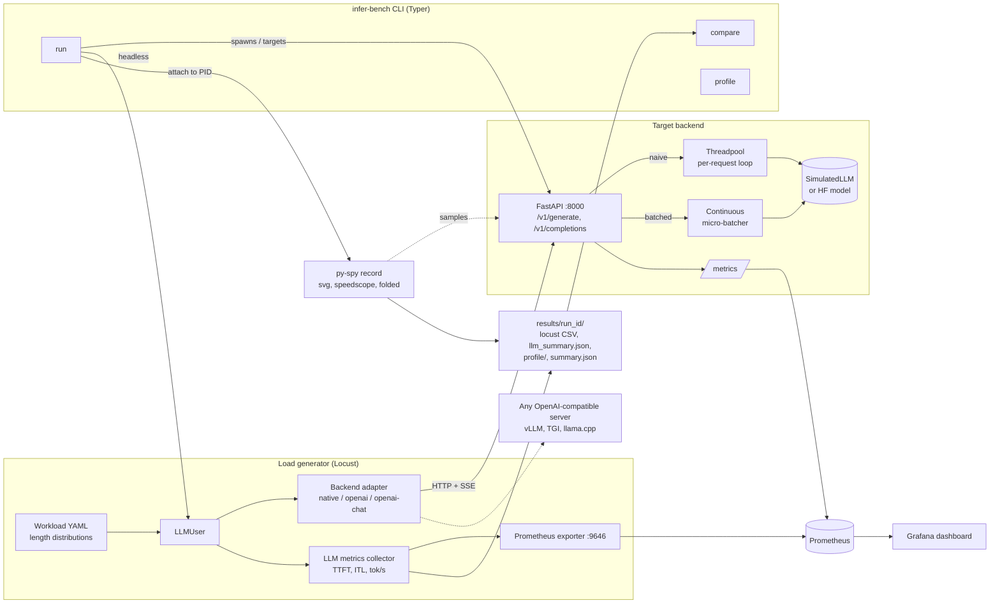

# infer_bench

**Load & profiling harness for LLM inference.**

infer_bench load-tests LLM inference backends and shows where the time goes. It:

- **drives load with Locust**, using workloads defined in YAML (distributions of prompt and
  output length, streaming or not, think time), against the bundled server or any
  OpenAI-compatible endpoint (vLLM, TGI, llama.cpp server, ...);
- **measures what matters for LLMs**: time-to-first-token (TTFT), inter-token latency,
  per-request decode speed, output tokens/sec, end-to-end latency percentiles and error rate;
- **profiles the server's CPU with py-spy** during the run (flamegraph SVG, speedscope JSON and
  a hotspot table built from collapsed stacks);
- **streams live metrics to Prometheus and Grafana** from both sides: what the server reports
  and what the clients actually see;
- **stores every run** in its own folder and **compares runs** (throughput ratios, latency
  deltas, and which functions gained or lost profile share).

It ships a **reference FastAPI inference server** with two serving modes so you can see the
effect of an optimisation end to end:

| Mode | How it serves | What limits it |
|---|---|---|
| `naive` | Each request runs its own generate loop on FastAPI's threadpool, one sequence per forward step | GIL contention, and paying the per-step overhead separately for every request |
| `batched` | An async queue feeds a continuous micro-batcher. One decode step moves every active sequence forward, sequences join and leave between steps | Per-sequence marginal cost |

With the default cost model (8 ms overhead per step, 1 ms per sequence, half of it CPU-bound),
`batched` should reach about 3x or more of `naive`'s output-token throughput at 32 concurrent
users. Run `scenarios/naive_vs_batched.sh` to measure it on your machine.

## Architecture



### Run flow (`infer-bench run --spawn-server --profile`)

1. Create `results/<timestamp>_<label>/` and write `config.json`.
2. Start the reference server (or use `--target` to point at one that is already running) and
   wait for `/health`.
3. Attach py-spy to the server PID in non-blocking mode for the length of the test.
4. Run Locust headless. Every request goes through the backend adapter, streamed tokens are
   timed one by one, and the samples go to Locust, the in-process collector and the Prometheus
   exporter.
5. On test stop, the locustfile writes `llm_summary.json`. The CLI then merges it with Locust's
   CSV stats and the py-spy hotspots into `summary.json` and prints a headline table.

## Project layout

```
src/infer_bench/
  server/        config, SimulatedLLM + optional HF backend, micro-batcher, metrics, FastAPI app
  loadgen/       backend adapters, workload sampling, LLM metrics, Prometheus exporter, locustfile
  profiling/     py-spy wrapper + collapsed-stack hotspot analysis
  results/       run directories, summary building, run comparison
  cli.py         `infer-bench` entry point
workloads/       example workload YAMLs (chat_short, summarize_long, throughput)
scenarios/       naive_vs_batched.sh, external_openai.sh
deploy/          Prometheus config, Grafana provisioning + dashboard
tests/           pytest suite
```

## Requirements

- Python 3.10+
- `py-spy` (installed as a dependency). **On macOS it needs root**, so pass `--sudo-pyspy`
  or run the profiling step with `sudo`. On Linux it needs ptrace permission
  (`kernel.yama.ptrace_scope=0`, or the `SYS_PTRACE` capability in containers).
- Docker + Docker Compose for the Prometheus/Grafana stack (optional).
- You don't need a GPU or model weights. The default backend is a simulated model. The
  optional `hf` backend (`pip install -e ".[hf]"`) runs a small HuggingFace model on CPU.

## How to run

### 1. Install

```bash
python -m venv .venv && source .venv/bin/activate
pip install -e ".[dev]"
cp .env.example .env   # optional: tweak server cost model, ports, API key
```

### 2. Start the reference server

```bash
infer-bench serve --mode batched --port 8000
# or: INFER_BENCH_MODE=naive uvicorn infer_bench.server.app:create_app --factory
curl -s localhost:8000/v1/generate -d '{"prompt":"hello","max_new_tokens":8}' -H 'content-type: application/json'
```

### 3. Run a load test

```bash
# against the already-running server
infer-bench run --workload workloads/chat_short.yaml --users 32 --duration 60 --label chat

# spawn the server for the run and profile it with py-spy (macOS: add --sudo-pyspy)
infer-bench run --spawn-server --mode naive --target http://127.0.0.1:8100 \
    --workload workloads/throughput.yaml --users 32 --duration 60 --label naive --profile
```

Each run writes `results/<timestamp>_<label>/`:

| File | Contents |
|---|---|
| `config.json` | the run parameters |
| `locust_stats.csv`, `locust_stats_history.csv`, `locust_report.html` | Locust output |
| `llm_summary.json` | TTFT / ITL / tokens/sec percentiles from the client |
| `profile/profile.svg` | py-spy flamegraph |
| `profile/profile.speedscope.json` | open in https://www.speedscope.app |
| `profile/profile.folded` | collapsed stacks, used for the hotspot table |
| `summary.json` | everything merged, used by `compare` |

### 4. Compare runs

```bash
./scenarios/naive_vs_batched.sh                  # runs both modes, then compares them
infer-bench compare results/<naive_run> results/<batched_run> --markdown report.md
```

### 5. Benchmark an external OpenAI-compatible server

```bash
TARGET=http://gpu-box:8000 MODEL=meta-llama/Llama-3.1-8B-Instruct ./scenarios/external_openai.sh
# protected endpoint: export INFER_BENCH_API_KEY=... (sent as a Bearer token)
```

### 6. Live dashboards (Prometheus + Grafana)

```bash
docker compose up -d                         # server (batched), Prometheus :9090, Grafana :3000
docker compose --profile loadgen up -d       # also Locust with its web UI on :8089
```

Open Grafana at http://localhost:3000. The **infer_bench — LLM inference under load**
dashboard is provisioned automatically and shows request and token throughput, server vs
client latency and TTFT percentiles, batch size, queue depth, decode step time and
inter-token latency. Prometheus also scrapes `host.docker.internal:8000` and `:9646`, so
`infer-bench serve` / `infer-bench run` started on the host show up on the same dashboard.

To run Locust interactively without the CLI:

```bash
locust -f src/infer_bench/loadgen/locustfile.py --host http://localhost:8000 \
    --workload workloads/chat_short.yaml --backend native
```

### Profiling an arbitrary process

```bash
infer-bench profile --pid <server_pid> --duration 30 --out results/profile-adhoc
```

## How to test

```bash
pip install -e ".[dev]"
pytest -q
```

The suite covers the simulated model (determinism, cost accounting), the micro-batcher
(batched output matches unbatched output, batch-size cap, queue back-pressure), both serving
modes through FastAPI's `TestClient` (JSON, SSE streaming, OpenAI-compatible endpoint,
`/metrics`), workload sampling, backend adapters and SSE parsing, client-side metric
aggregation, py-spy collapsed-stack parsing, and summary building and comparison. The tests
don't need py-spy, Locust processes, Docker or network access.

Lint with `ruff check src tests`.

## Configuration

Server settings come from `INFER_BENCH_*` environment variables or `.env` (see `.env.example`):
serving mode, backend, batch size and wait window, and the simulated cost model (step overhead,
per-sequence cost, prefill cost, CPU-bound fraction). Set `cpu_bound_fraction` higher to make
the GIL the bottleneck, as in tokenizer- or Python-heavy serving stacks, or lower to imitate
GPU-bound serving where the server mostly waits.
